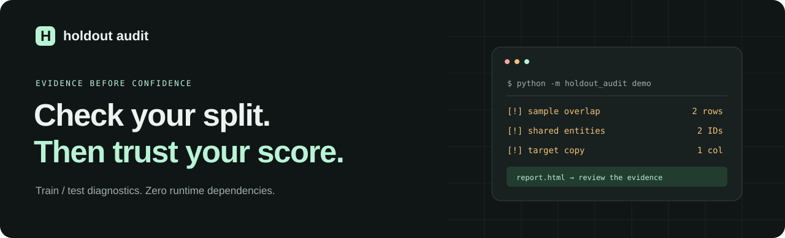
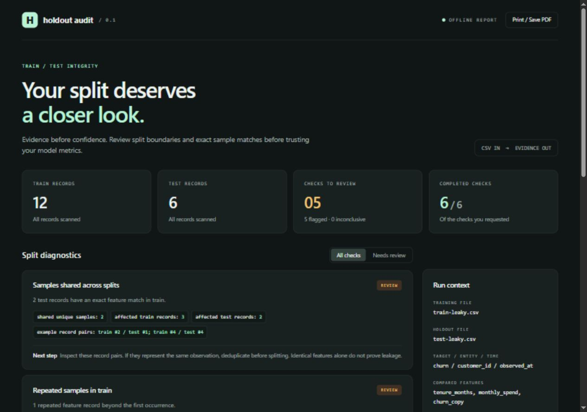

<p align="center">
  
</p>

<p align="center">
  <strong>Local train/test split checks. Clear evidence. One command.</strong>
</p>

<p align="center">
  
  
  
  <a href="LICENSE"></a>
</p>

<p align="center">
  <a href="#try-it-in-30-seconds">Quickstart</a> ·
  <a href="#what-it-checks">Checks</a> ·
  <a href="#use-your-own-data">Your data</a> ·
  <a href="#python-api">Python API</a> ·
  <a href="#limitations">Limitations</a>
</p>

---

Your model's test score is only useful if the split reflects what you want to predict.

**Spliv** inspects two CSV files for exact sample overlap, repeated observations, shared entities, time-order violations, and features that copy the target. It returns counts, record references, and practical next steps in a readable terminal summary, an offline HTML report, and optional JSON.

No model training. No API keys. No uploads. No automatic data changes.

## Try it in 30 seconds

Download or clone this repository, then run:

```bash
cd holdout-audit
python -m spliv demo
```

Open **`report.html`** in your browser. That's the entire setup—Python 3.10+ is the only runtime requirement.



The synthetic demo deliberately contains **five flagged checks**:

```text
[!] Samples shared across splits: 2 test records have an exact feature match in train.
[!] Repeated samples in train: 1 repeated feature record beyond the first occurrence.
[+] Repeated samples in test: 0 repeated feature records beyond the first occurrence.
[!] Entities shared across splits: 2 nonmissing entity IDs occur in both splits.
[!] Strict future holdout: Train does not end strictly before test begins.
[!] Target copied into a feature: 1 feature column exactly matches the target in every record.
```

Compare with the repaired fixture:

```bash
python -m spliv demo --clean --output clean-report.html
```

Both demo commands return exit code 0 by default, so you can explore the reports. Use `--fail-on warning` to turn the demo into a gate. The fixtures are invented examples, not benchmark results or evidence of model performance.

## What it checks

| Check | What the evidence means | Enable |
| :--- | :--- | :--- |
| **Sample overlap** | Test records have feature values exactly matching a train record | Always |
| **Train duplicates** | Feature records repeat within train | Always |
| **Test duplicates** | Feature records repeat within test | Always |
| **Entity overlap** | Nonmissing entity IDs occur in both splits | `--group customer_id` |
| **Strict future holdout** | Every train timestamp must precede every test timestamp; ties are flagged | `--time observed_at` |
| **Target copies** | A feature exactly matches the target across every record in both splits | `--target churn` |

**Findings require interpretation.** Two observations can legitimately have identical features. Shared customers can be appropriate when forecasting known customers. A column matching the target may be a legitimate predictor. The report surfaces evidence; you decide whether it violates your evaluation goal.

## Use your own data

```bash
python -m spliv audit train.csv test.csv --target churn --group customer_id --time observed_at --ignore record_id --output audit.html --json audit.json
```

Target, entity, timestamp, and ignored columns are excluded from feature matching. **Exclude record IDs:** otherwise unique IDs can hide identical feature samples. Repeat `--ignore` for additional metadata columns.

### CI gate

```bash
python -m spliv audit train.csv test.csv --target churn --ignore record_id --fail-on warning --output audit.html
```

| Exit | Meaning |
| :--- | :--- |
| `0` | Requested checks met the chosen gate policy, or gating was disabled |
| `1` | A finding meets the chosen severity threshold, or a requested check is incomplete |
| `2` | Input, argument, or output error |

`audit` defaults to `--fail-on warning`. `--fail-on error` gates exact sample overlap and target copies, while allowing complete warning-level findings. Incomplete requested checks still fail either gate. `--fail-on none` exports findings without gating.

Reports are written even when the gate returns 1. Parent output directories must exist. Existing report files are replaced; input CSVs cannot be used as output paths. Filenames should end in `.html` / `.json` for convenient viewing.

### Optional installation

```bash
python -m pip install .
spliv demo
```

This installs from the local repository. The project is not currently published to PyPI. Installation may download the setuptools build backend; running from the checkout requires no installation or network access.

## Python API

```python
from spliv import audit
from spliv.render import render_html

report = audit(
    "train.csv",
    "test.csv",
    target="churn",
    group="customer_id",
    time="observed_at",
    ignore=("record_id",),
)

print(report.verdict)
print(report.to_dict())

with open("audit.html", "w", encoding="utf-8") as output:
    output.write(render_html(report))

if report.fails("warning"):
    raise SystemExit(1)
```

The JSON schema is versioned (`schema_version: 1`). Check statuses are `pass`, `flag`, `inconclusive`, and `skipped`. Each check includes evidence, severity, completeness, and a suggested next step.

## Input rules & privacy

- UTF-8, comma-delimited CSVs with unique, nonblank headers and consistent record widths. A UTF-8 BOM and quoted multiline cells are supported. Both splits must contain the same named columns; column order may differ.
- Feature comparisons use **exact CSV string equality**. `1` and `1.0`, or `a` and ` a`, are different. Missing feature strings remain part of the feature key.
- For entity, time, and target completeness, empty strings and case-insensitive `na`, `n/a`, `nan`, `null`, and `none` are treated as missing. Do not use those strings as real entity IDs or target labels.
- Dates/timestamps use Python's ISO 8601 parser. Naive timestamps are compared consistently as UTC; mixed naive/aware values make the time check inconclusive. Offset-aware timestamps are converted to UTC for comparison.
- Missing entity IDs or invalid timestamps cannot produce a fully completed check. Target-copy evaluation requires complete targets and at least two distinct training target values.
- Raw cell values are never exported. Reports include **filenames, column labels, counts, and up to five record pairs**. Record numbers start at 1 after the header and refer to CSV records, not physical lines. Review metadata before sharing a report.
- Generated HTML has no external assets or network calls. Data-dependent text is HTML-escaped. The tool never edits your datasets.

## Limitations

Spliv **does not certify a dataset as leakage-free**. It does not inspect training code or detect preprocessing fitted on test data, near-duplicates, numeric-equivalent encodings, transformed target proxies, outcome-derived features, or whether a feature existed at prediction time.

It scans all rows and holds both CSVs and comparison indexes in memory. This version is intended for datasets that fit comfortably in RAM, not multi-gigabyte data lakes. There is no approximate matching or sampling.

The repaired demo removes an outcome-copy feature and repeated samples, uses separate entity sets, and places train before test. It illustrates these checks only; copying its repairs into a real dataset is not a substitute for designing the evaluation protocol.

For pipeline-level prevention, see [scikit-learn's data leakage guidance](https://scikit-learn.org/stable/common_pitfalls.html#data-leakage). Larger data-quality or runtime-instrumentation tools may be more appropriate when you need broader checks. Spliv focuses on a small, inspectable CSV workflow with no runtime dependencies.

## Development

```bash
python -m unittest discover -s tests -v
```

The suite exercises detection counts, randomized comparisons against a brute-force oracle, timezones, malformed CSVs, incomplete checks, HTML injection, private-value redaction, exit codes, input protection, and a real CLI subprocess. GitHub Actions is configured for Python 3.10, 3.12, and 3.14 on Ubuntu and Windows, plus an installed-package smoke check.

Want to help? Read [CONTRIBUTING.md](CONTRIBUTING.md). Useful contributions include adversarial fixtures, clearer explanations, and well-defined new checks with false-positive examples.

If this saves you a debugging session, a star helps other people find it.

---

Built by **Akshay Sekhar** · [GitHub](https://github.com/zorox06) · [MIT License](LICENSE)
